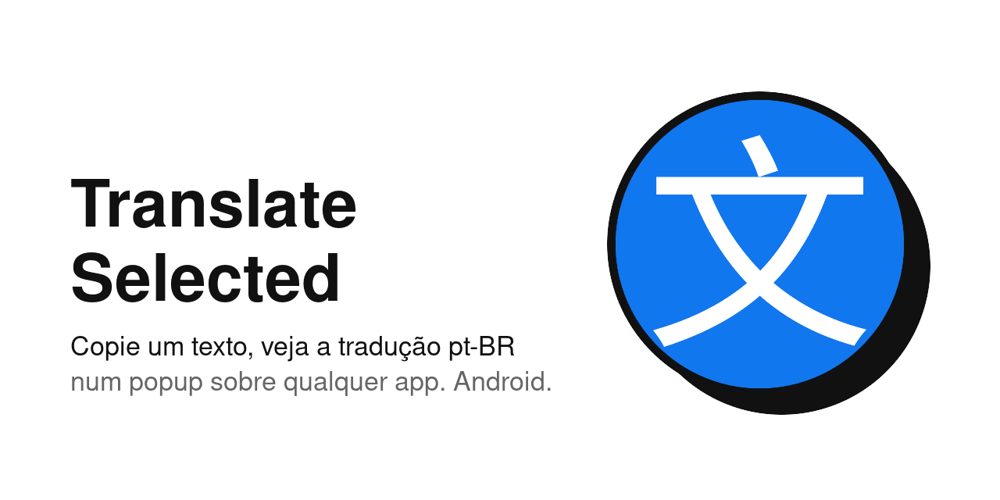

<p align="center">
  
</p>

# translate-selected-android

## Download

**Latest version:** https://github.com/C0nanT/translate-selected-android/releases/latest/download/translate-selected.apk


Scan with your phone camera to download. Step-by-step install guide (pt-BR, including the Play Protect warning): [docs/INSTALL.md](docs/INSTALL.md).

## About

Android (Kotlin) version of [translate-selected](https://github.com/C0nanT/translate-selected): copy text in any app (PDF reader, browser, etc.) and see the pt-BR translation in a popup at the bottom of the screen, over the app.

Made for reading English books on a mobile device and only checking the translation when you get stuck on a sentence.

**Desktop (Linux/X11, Python + GTK):** https://github.com/C0nanT/translate-selected

How it works: copy the text and tap the floating bubble **文**. It works in any reader, including the Files by Google PDF viewer.

Tested on a Lenovo TB336FU tablet with Android 16, reading a PDF in Files by Google.

## Requirements

- Android 6+
- USB debugging on (only for `make android`)
- Android SDK at `~/Android/Sdk` (or `ANDROID_HOME`) and Java 17+

```bash
make android      # builds the debug APK and installs it on the device via USB
make android-apk  # only builds the APK
```

The APK is at `app/build/outputs/apk/debug/app-debug.apk`. To install it by hand, copy the file to the device, open it in the file manager and allow installing from unknown sources.

## Releases

Each tag `v*` pushed to GitHub builds a signed APK and publishes it on [Releases](https://github.com/C0nanT/translate-selected-android/releases). How it works, how to release a version, the signing key and troubleshooting: [docs/DEPLOY.md](docs/DEPLOY.md).

## Bubble

- Turn on: tap the **Tradutor** icon in the app list. The first time, it opens the "Sobrepor a outros apps" screen: enable it for Tradutor and tap the icon again
- On Android 13+, when you turn the bubble on the app asks for notification permission (to show "Toque para desligar"); denying it does not prevent the bubble from working
- Turn off: hold your finger still on the bubble until it vibrates, or tap the "Bolha do Tradutor ligada" notification
- Short tap translates; drag the bubble to move it (past the system touch slop, it neither translates nor turns off)
- The bubble remembers where it was left: when turned on again it returns to the last place, adjusted to the screen (also after rotating or switching devices)
- After the device restarts, the bubble does not come back on its own: tap the icon again
- Android shows "Tradutor colou da área de transferência" on every translation; this is expected

## Usage

- Copy the text and tap the bubble -> "Traduzindo…" appears, then the translation
- Hides by itself in 15 s; the bar at the bottom shows the remaining time
- Holding a finger on the popup pauses the time
- Hold still until it vibrates, then drag to move the popup; the next ones open there (dragging without holding scrolls the text)
- Tap outside -> the popup closes
- Request failure -> red popup with the reason
- Text over 3000 characters -> "Texto grande demais (N caracteres)" warning

## Configuration

Constants in `app/src/main/java/com/conan/translator/Config.kt` (`HIDE_AFTER_S`, `POPUP_CHARS`) and, for the translation rules, in the core at `core/src/main/kotlin/com/conan/translator/Limits.kt` (`MAX_CHARS`, `MAX_URL`):

| Constant | Default | What it does |
|---|---|---|
| `HIDE_AFTER_S` | 15 | the popup hides by itself after this time |
| `MAX_CHARS` | 3000 | selections larger than this (counted by code point: an emoji counts as 1) show the "Texto grande demais" warning |
| `MAX_URL` | 8000 | cap on the already-encoded URL (accents and emoji inflate it); above it, shows the same warning. Conservative value, not yet measured on the device |
| `POPUP_CHARS` | 80 | maximum popup width, in characters |

Warnings in the red popup when tapping the bubble: "Nada copiado" (clipboard empty, holding an image/file, or reading blocked) and "Nada para traduzir" (text with no letters, such as "42"; no request is made).

After changing these, run `make android`.

**Privacy:** text is only sent to Google Translate when you tap the bubble, not on every selection or copy.

## Development

- **Core**: pure rules, no UI and no network, in `core/` (Kotlin, a Gradle module without Android; importing `android.*` there fails the build on purpose).
- **App**: what is specific to Android, in `app/` (bubble, popup, Quick Settings tile and HTTP).
- **`cases/`**: JSON files with input -> expected output, read by the core tests. They are the single source of truth for behavior.

**Rule: when behavior changes, change the case first.** Write or adjust the case in `cases/` and only then the code. The stopwatch and position clamping do not use `cases/`: they have direct tests.

**`cases/` is duplicated in the [desktop repo](https://github.com/C0nanT/translate-selected)**, whose Python core (`pc/core.py`, referenced in comments here) follows the same rules. When a case changes here, copy the change there too (and vice versa), or the two versions drift apart.

| Command | What it does |
|---|---|
| `make test` | unit tests (core and app, via Gradle, no device) |
| `make android` | builds the debug APK and installs it via USB |
| `make android-apk` | only builds the APK |
| `make hooks` | enables the pre-push hook versioned in `hooks/`, which runs `make test` before each `git push`. Run once per clone; repeating it is safe |

Without Java or the Android SDK the push is blocked with a clear message; `git push --no-verify` skips the check.
